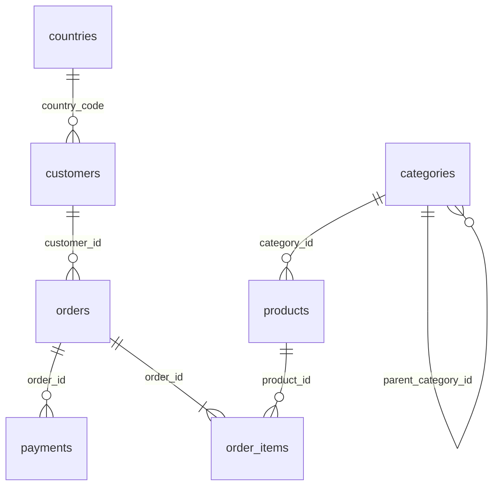

# 02 – Schema dữ liệu `shop` (script: `sql/02_schema.sql`)

Mô hình **e-commerce** gọn: **7 bảng** liên kết bằng khóa ngoại trong schema `shop` của database `shopdb`.
Mục tiêu là **đa dạng chứ không nhiều**: mỗi loại khóa, ràng buộc, index đều có ví dụ.
Script chỉ dùng tính năng có sẵn của PostgreSQL, không cần extension.

```bash
sudo -u postgres psql -d shopdb -f sql/02_schema.sql
```

> ⚠️ Script chạy `DROP SCHEMA IF EXISTS shop CASCADE`, nên mọi dữ liệu cũ trong schema `shop` sẽ bị xóa.

## 1. Sơ đồ quan hệ (ERD)



## 2. Kiểu dữ liệu tự định nghĩa

| Object | Loại | Định nghĩa | Dùng ở |
|--------|------|------------|--------|
| `shop.order_status` | ENUM | PENDING, PAID, PROCESSING, SHIPPED, DELIVERED, CANCELLED, RETURNED | `orders.order_status` |
| `shop.money_amount` | DOMAIN | `numeric(12,2) CHECK (VALUE >= 0)` | mọi cột tiền |

## 3. Bảng

| Bảng | Mô tả | Khóa chính | Khóa ngoại | Ràng buộc khác | Số dòng (scale=0.44, mặc định) |
|------|-------|-----------|-----------|----------------|------------------:|
| `countries` | Quốc gia, tiền tệ, thuế | `country_code` (khóa tự nhiên) | – | CHECK `tax_rate` 0..1 | 30 |
| `categories` | Cây danh mục cha/con | `category_id` (identity ALWAYS) | `parent_category_id → categories` (**tự tham chiếu**, ON DELETE SET NULL) | – | 30 |
| `customers` | Khách hàng | `customer_id` (identity BY DEFAULT) | `country_code → countries` | CHECK email regex, gender, loyalty_tier | 220,000 |
| `products` | Sản phẩm + thuộc tính JSONB + tồn kho | `product_id` | `category_id → categories` | UNIQUE `sku`, CHECK giá > 0, `stock_qty >= 0`, **CHECK nhiều cột** `unit_cost <= unit_price` | 22,000 |
| `orders` | Đơn hàng | `order_id` | `customer_id → customers` | UNIQUE `order_number`, CHECK `sales_channel` | 1,672,000 |
| `order_items` | Dòng đơn hàng | `order_item_id` | `order_id → orders` (**ON DELETE CASCADE**), `product_id → products` | **UNIQUE nhiều cột** (`order_id`, `line_no`), CHECK quantity, discount | ~5,020,000 |
| `payments` | Thanh toán | `payment_id` | `order_id → orders` (CASCADE) | CHECK `payment_method`, `payment_status` | ~1,672,000 |

## 4. Index – mỗi loại một cái (19 index)

Có 10 index tự sinh từ ràng buộc: 7 PRIMARY KEY và 3 UNIQUE (`products.sku`, `orders.order_number`,
`order_items(order_id, line_no)`). Ngoài ra script tạo thêm **9 index**:

| Loại | Index | Bảng (cột) | Phục vụ truy vấn |
|------|-------|-----------|------------------|
| B-tree trên cột FK | `idx_order_items_product` | order_items (product_id) | doanh số theo sản phẩm, JOIN |
| B-tree trên cột FK | `idx_payments_order` | payments (order_id) | lấy thanh toán của đơn |
| **Composite** | `idx_products_category_price` | products (category_id, unit_price) | lọc danh mục + khoảng giá |
| **Covering (INCLUDE)** | `idx_orders_customer_date` | orders (customer_id, order_date DESC) INCLUDE (order_status, total_amount) | lịch sử đơn của khách → *Index Only Scan* |
| **Partial** | `idx_orders_status_open` | orders (order_date) WHERE status IN (PENDING, PAID, PROCESSING) | đơn chưa xử lý |
| **Unique expression** | `uq_customers_email_lower` | customers (lower(email)) | email duy nhất, không phân biệt hoa thường |
| **GIN** (jsonb_path_ops) | `idx_products_attributes_gin` | products (attributes) | `attributes @> '{"color":"Red"}'` |
| **BRIN** | `idx_payments_paid_at_brin` | payments (paid_at) | lọc theo khoảng thời gian, index rất nhỏ |
| **Hash** | `idx_payments_txn_ref_hash` | payments (transaction_ref) | tìm chính xác theo mã giao dịch |

Bước 05 thêm 8 index nữa (trigram, GiST trên `point`, exclusion, index của MV…). Tổng cả database là **27 index**.

## 5. Dữ liệu – `sql/03_insert_data.sql`

```bash
# Chạy thử nhanh với 1% dữ liệu (~40 MB)
sudo -u postgres psql -d shopdb -v scale=0.01 -f sql/03_insert_data.sql
# Bản đầy đủ (scale = 0.44, mặc định): ~1.5 GB. Muốn ~2.35 GB thì -v scale=0.7, ~3.4 GB thì -v scale=1
sudo -u postgres psql -d shopdb -f sql/03_insert_data.sql
```

* Dữ liệu tiếng Anh: tên người, thương hiệu, sản phẩm, mô tả… Sinh hoàn toàn bằng SQL
  (`generate_series` + `random()` có `setseed`).
* Phần đơn hàng nạp theo lô 250.000 đơn, mỗi lô `COMMIT` một lần và in tiến độ ra NOTICE.
* Tổng tiền đơn (`subtotal`, `discount`, `tax`, `total`) được tính khớp với `order_items`.
* Dữ liệu được sinh để index thực sự được dùng: ngày tăng dần theo id (BRIN), sản phẩm bán chạy phân bố lệch,
  khoảng 13% đơn ở trạng thái "mở" (partial index), JSONB có màu, chất liệu, size.
* Chạy lại được nhiều lần (đầu script có `TRUNCATE ... RESTART IDENTITY`).
* Kết quả đo khi chạy thử: scale 0.1 ra **335 MB**, nên scale 0.44 (mặc định) khoảng **1.5 GB**, scale 0.7 khoảng 2.35 GB, scale 1 khoảng 3.4 GB.

| Bảng | Dung lượng ước tính (scale=0.44, bảng + index) |
|------|------------------------------:|
| order_items | ~0.69 GB |
| orders | ~0.40 GB |
| payments | ~0.29 GB |
| customers | ~0.04 GB |
| products, countries, categories | ~0.01 GB |
